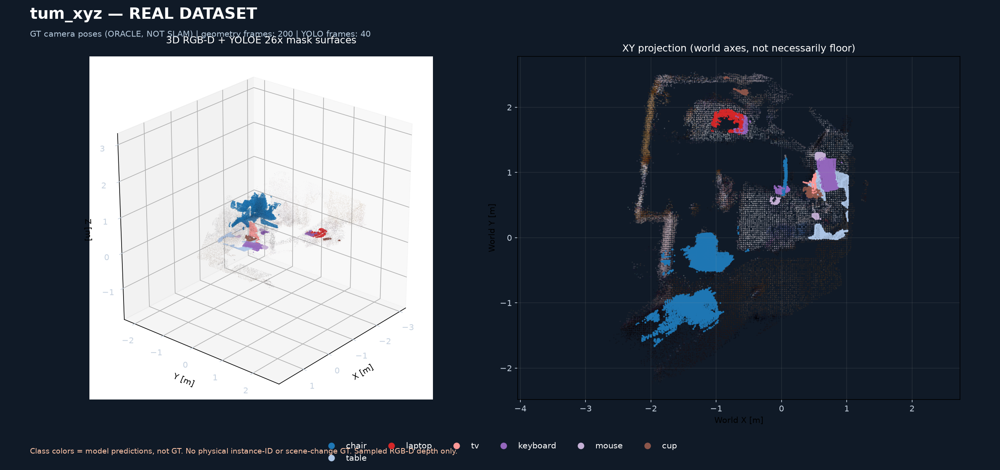
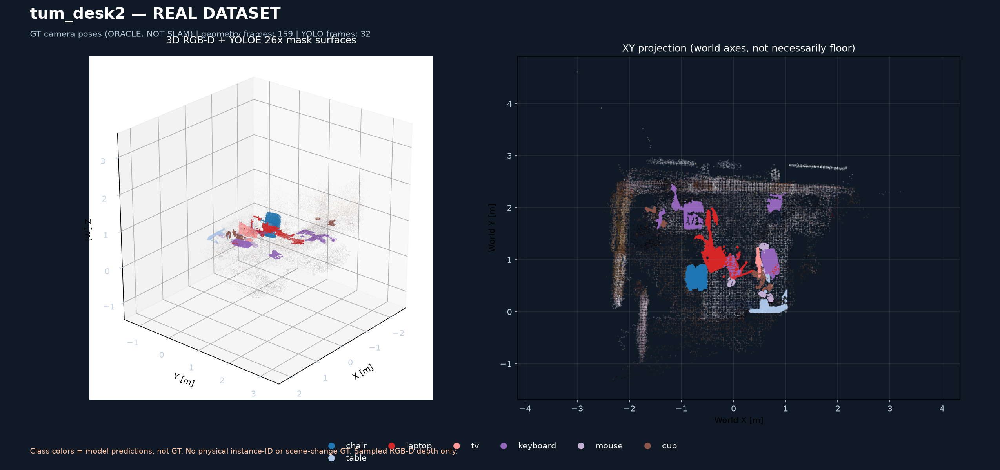
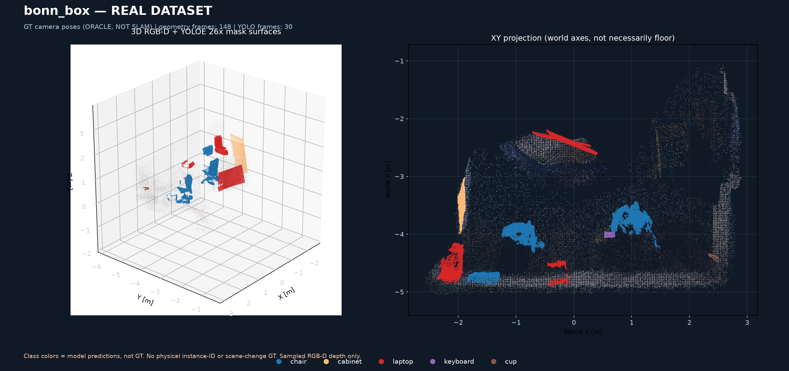

# D1 — карты реальных RGB-D датасетов: TUM xyz, TUM desk2, Bonn moving box

**Статус:** 3/3 real-dataset map jobs PASS. [Исходный GitHub Actions run #41594963441](https://github.com/KiRiII-C/cv_vlm/actions/runs/41594963441).

**Ключевое ограничение:** все три карты D1 реконструированы по GT/mocap позам (oracle registration), **не являются прогонами RTAB-Map SLAM**. Отдельная RTAB-Map карта TUM desk ранее построена без GT: [B7](https://github.com/KiRiII-C/cv_vlm/actions/runs/41484368417).

| Запись | Синхронные RGB-D | Кадры геометрии | Инференсы YOLOE-26x | Геометрические воксели | 3D-маски | Семантические воксели |
|---|---:|---:|---:|---:|---:|---:|
| tum_xyz | 798 | 200 | 40 | 53265 | 145 | 14270 |
| tum_desk2 | 635 | 159 | 32 | 136039 | 79 | 10901 |
| bonn_box | 590 | 148 | 30 | 185853 | 35 | 19592 |

## Реальные цветные 3D-карты

### tum_xyz

Обнаружения: `chair`: 41, `cup`: 40, `keyboard`: 39, `laptop`: 5, `mouse`: 15, `table`: 2, `tv`: 3.

Исходный файл-контейнер `d1-map-tum_xyz` из [запуска 41594963441](https://github.com/KiRiII-C/cv_vlm/actions/runs/41594963441) содержит `geometry_rgb.ply`, `semantic_predicted.ply`, `interactive_map.html`, `map_overview.png`, `metrics.json`.

### tum_desk2

Обнаружения: `chair`: 14, `cup`: 10, `keyboard`: 25, `laptop`: 15, `mouse`: 12, `table`: 2, `tv`: 1.

Исходный файл-контейнер `d1-map-tum_desk2` из [запуска 41594963441](https://github.com/KiRiII-C/cv_vlm/actions/runs/41594963441) содержит `geometry_rgb.ply`, `semantic_predicted.ply`, `interactive_map.html`, `map_overview.png`, `metrics.json`.

### bonn_box

Обнаружения: `cabinet`: 1, `chair`: 23, `cup`: 1, `keyboard`: 2, `laptop`: 8.

Исходный файл-контейнер `d1-map-bonn_box` из [запуска 41594963441](https://github.com/KiRiII-C/cv_vlm/actions/runs/41594963441) содержит `geometry_rgb.ply`, `semantic_predicted.ply`, `interactive_map.html`, `map_overview.png`, `metrics.json`.

## Методология и ограничения

Действительно использованные исходные измерения: 16UC1 depth, RGB, синхронизированные штампы времени, GT или mocap позы камеры. Геометрия: каждые 4 кадра, каждый 4-й пиксель, 3 см voxel. Семантика YOLOE-26x: каждые 20 кадров, confidence >= 0.40, 2 см voxel по каждому классу.

Все объекты выделены цветом **по предсказанию YOLOE**, а геометрия окрашена из оригинального RGB. Неизвестная глубина не была заполнена искусственно. Две TUM последовательности относятся к одному семейству датасета; Bonn содержит динамические объекты. Движущиеся поверхности на накопленной карте Bonn могут создавать фантомную геометрию.

**НЕЛЬЗЯ считать** число 3D масок, вокселей или визуально красивую карту точностью семантической сегментации, IDF1, реальным scene-change F1, SLAM ATE, автоматической релокализацией или готовностью Nav2. Для этого нужны отдельные датасетные GT и эксперименты без GT-поз внутри SLAM.

## Следующий эксперимент

RTAB-Map без GT на каждом датасете, затем post-hoc SE(3) ATE и сравнение полученных геометрических карт с oracle; отдельно — физическая смена ID на последовательностях с размеченными объектами.
