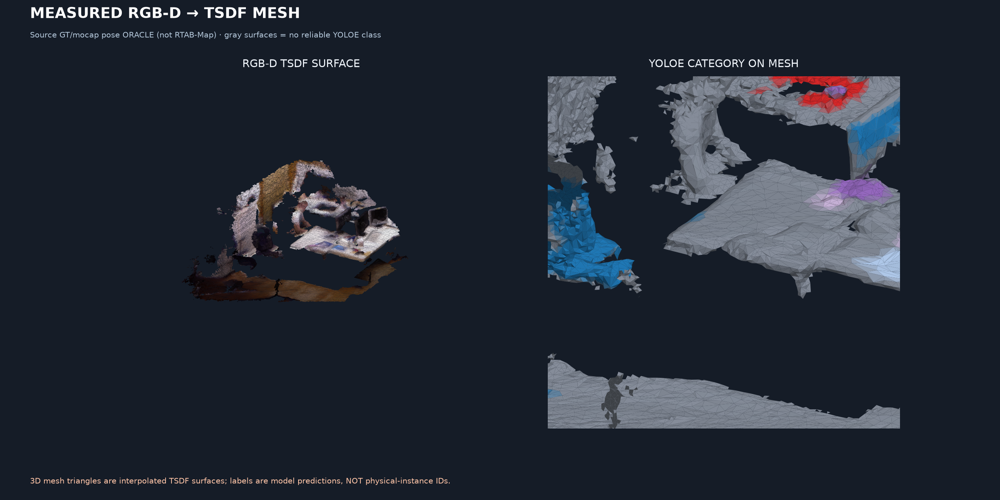
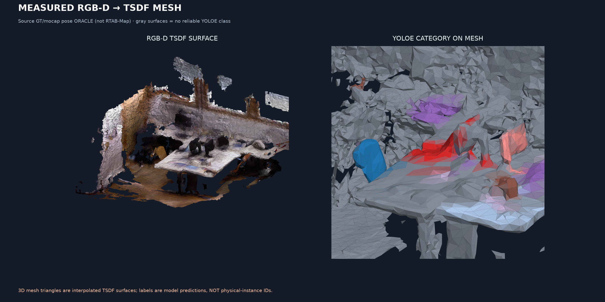
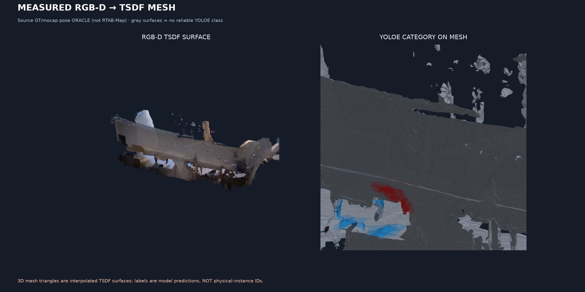

# D2 — OVI-MAP-inspired *mesh rendering* of real RGB-D datasets

**Status:** all 3 original measured RGB-D TSDF reconstruction jobs PASS. [GitHub Actions #41636779092](https://github.com/KiRiII-C/cv_vlm/actions/runs/41636779092).

**Not an OVI-MAP implementation:** this experiment borrows the meshed-surface + semantic-layer display style, but it uses GT/mocap poses (oracle), not a new SLAM pass, and YOLOE predictions, not OVI class-agnostic IDs or VLM embeddings.

| Dataset | Real RGB-D frames integrated | Original mesh triangles | Semantic mesh support | Semantic coverage |
|---|---:|---:|---:|---:|
| tum_xyz | 200 | 129533 | 9756 | 13.60% |
| tum_desk2 | 159 | 346797 | 6955 | 3.68% |
| bonn_box | 148 | 282870 | 11534 | 7.57% |

## Real-data reconstructed surface previews

### tum_xyz

Binary full-resolution mesh PLY, GLB, self-contained interactive viewer and semantic support masks: [tum_xyz job artifact](https://github.com/KiRiII-C/cv_vlm/actions/runs/41636779092) (`d2-tsdf-surface-tum_xyz`).

### tum_desk2

Binary full-resolution mesh PLY, GLB, self-contained interactive viewer and semantic support masks: [tum_desk2 job artifact](https://github.com/KiRiII-C/cv_vlm/actions/runs/41636779092) (`d2-tsdf-surface-tum_desk2`).

### bonn_box

Binary full-resolution mesh PLY, GLB, self-contained interactive viewer and semantic support masks: [bonn_box job artifact](https://github.com/KiRiII-C/cv_vlm/actions/runs/41636779092) (`d2-tsdf-surface-bonn_box`).

## What this experiment actually fixes

Compared with D1 scatter-only maps: continuous TSDF triangle surfaces, real RGB colors, light shading, side-by-side natural RGB and YOLOE semantic overlay, unknown-space abstention, and tighter camera framing.

**Scientific limits:** TSDF zero-crossings are interpolated geometry between real observed rays; they are not newly measured points. A smoother mesh is not evidence of more accurate geometry, instance-ID tracking or semantics. Bonn motion ghosts remain; some geometry is unknown or poorly reconstructed. No GT instance labels or open-set SigLIP query heatmaps were generated. This is an oracle GT-pose visual reconstruction, not RTAB-Map ATE validation.

To obtain true OVI-like instance maps, next implement geometry-first class-agnostic 3D instance integration and temporal ID voting, then connect semantic embeddings via selected views. To compare photographs with OVI figures, add a Replica/ScanNet dataset run with identical scene and pose conditions.
