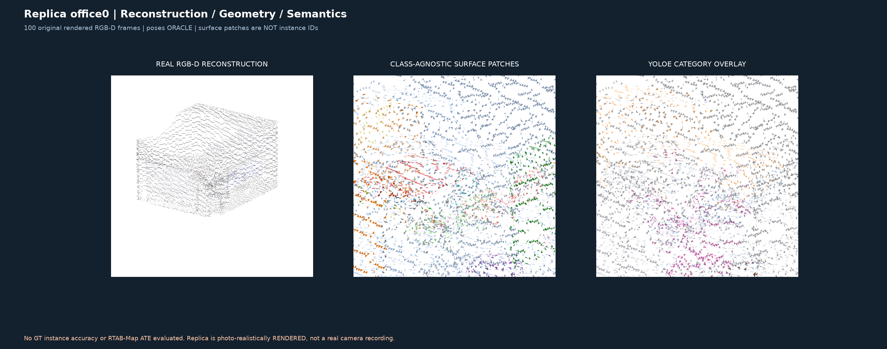

# D3 — Replica office0: reconstruction, geometric patches, YOLOE semantics

**Status:** verified real source of photo-realistic Replica RGB-D renders, 100 / 100 images.
[GitHub Actions run 41641015204](https://github.com/KiRiII-C/cv_vlm/actions/runs/41641015204).
**This is NOT RTAB-Map and does not report an OVI-MAP inference comparison.**
Input camera poses are GT oracle and the sequence is computer-rendered, not from a real RGB-D sensor.

| Metric | Result |
|---|---:|
| Original rendered RGB-D images | 100 |
| 3D mesh faces | 284772 |
| Mesh vertices | 145884 |
| YOLOE-26x inference frames | 10 |
| Observed YOLOE class masks | 23 |
| Independent class-agnostic geometric surface patches | 40 |
| Mesh surface patch face coverage | 95.04% |
| Mesh vertex YOLOE category support | 13.75% |
| Held-out odd camera frames | 50 |
| Median odd-depth-to-even-mesh nearest vertex | 0.0099 m |
| 95th percentile odd-depth-to-even-mesh nearest vertex | 0.0152 m |
| Held-out sensor-depth points within 5cm of even-frame mesh | 99.85% |

**Critical distinction:** patches are geometric surface regions, NOT verified object instances or physical UUIDs.
YOLOE labels are model predictions and not instance-level or open-set SigLIP scores.
The 50 odd frames were held out of the first 50-even-frame TSDF for the sensor
consistency proxy, then integrated into the final 100-frame mesh.

**Artifacts:** `rgb_mesh.ply`, `rgb_mesh.glb`, `semantic_mesh.ply`,
`semantic_mesh.glb`, `mesh_patch_and_semantic_labels.npz`,
`interactive_office0.html`, and metrics in the
[run artifacts](https://github.com/KiRiII-C/cv_vlm/actions/runs/41641015204).

**Limitations:** the nearest mesh-vertex check is not independent 3D GT; the
reference screenshot in OVI-MAP may use GT-mesh vertex transfer; this is
an intentionally restricted 100-frame subset, whereas the official example
uses longer sequences. No physical-instance GT, direct OVI result, SLAM ATE,
relocalization, or Nav2 safety was evaluated.

**Next work:** on the same 100 frames evaluate class-agnostic instance
segmentation with 3D GT class/instance labels, add per-object view-selected
text embeddings and motion-aware long-term memory. Render isolated object meshes
in a separate layer to compare identity consistency.
