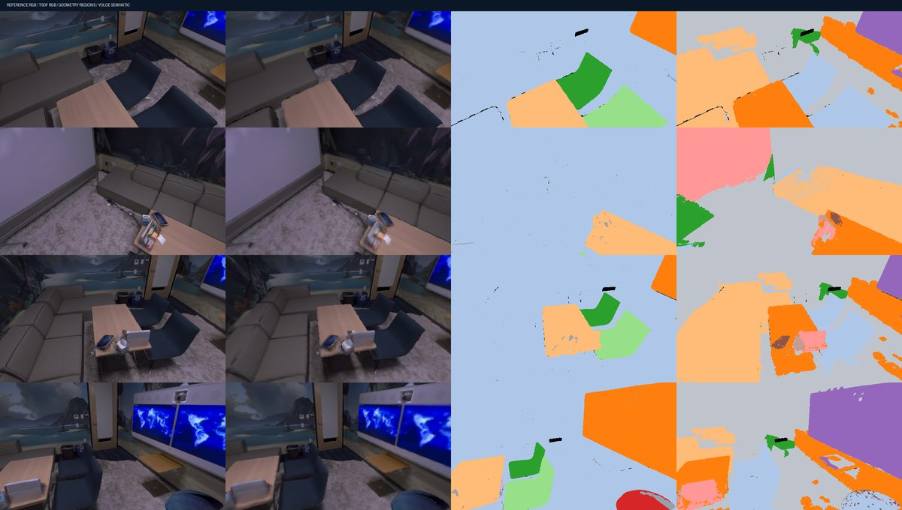

# D4 — full official Replica office0: real reconstruction quality audit

Status: PASS. The dataset is computer-rendered Replica, not physical RGB-D camera data.
Actual source 2000 frames; 500 RGB-D TSDF camera frames; 200 independent YOLOE-26x inference calls.
Camera poses are provided GT oracle. No RTAB-Map SLAM ran during this reconstruction.

| Quantity | Verified outcome |
|---|---:|
| Total original available frames | 2000 |
| Original frame integrations into mesh | 500 |
| YOLOE26x inference frames | 200 |
| Valid measured-depth semantic masks | 497 |
| Original mesh triangle faces | 555889 |
| Geometry patch mesh-face coverage | 98.41% |
| Semantic support mesh vertices | 36.12% |
| Held-out original depth frames excluded from TSDF | 25 |
| Raycast coverage of valid held-out depth | 99.86% |
| Supported ray median abs depth residual | 0.0092 m |
| Supported ray p95 abs depth residual | 0.0314 m |
| Independent GT mesh one-way distance median | 0.0154 m |
| Independent GT mesh one-way distance p95 | 1.8959 m |

Interpretation: raycast support detects missing or perforated geometry in the reconstructed map.
Depth residuals are evaluated only on raycast-supported pixels; both support and residuals must be reported.
One-way GT triangle distance evaluates reconstructed points to the independent GT surface; it does not measure completeness of unseen areas.
Geometric patches are not physical-instance labels; YOLOE colors are predictions, not GT.
No physical UUID IDF1, instance IoU, open-set VLM mAP, RTAB-Map ATE or navigation validation.

Full original measured-depth scene mesh PLY/GLB, aligned RGB/semantic renders,
interactive HTML and per-view metrics: [Actions run 41645799954](https://github.com/KiRiII-C/cv_vlm/actions/runs/41645799954),
artifact D4-FULL-2000-REPLICA-500-RGBD-TSDF-QUALITY.
