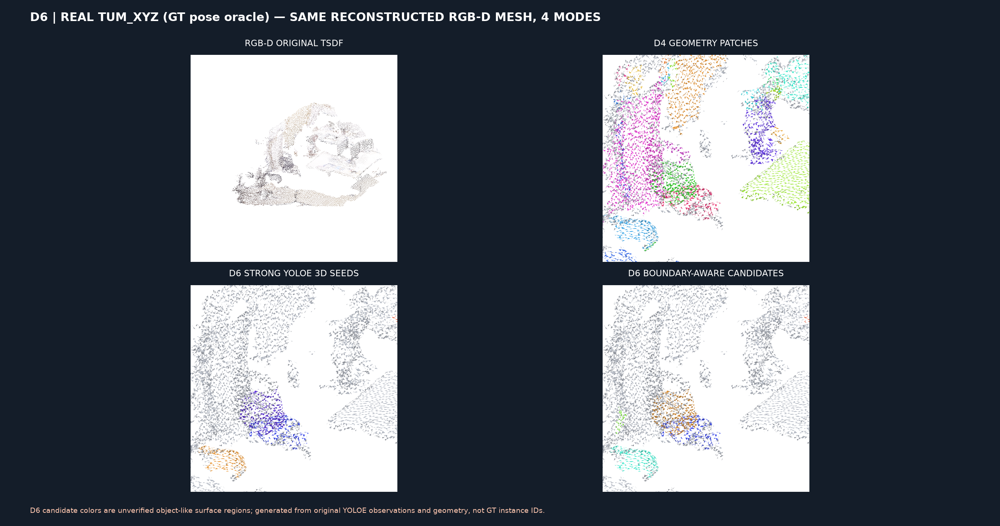
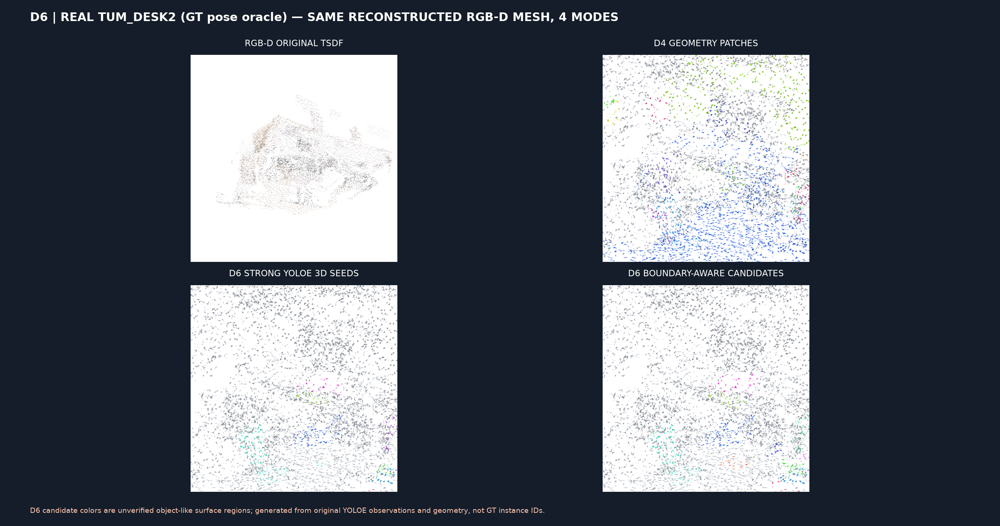
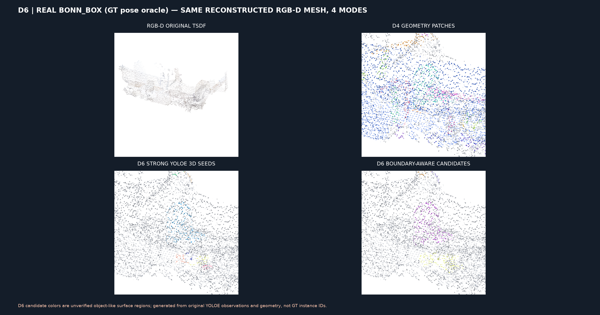

# D6-B — независимый RGB-D контроль кандидатных поверхностей на TUM и Bonn

**Status: all 3 real sensor records PASS.** [Actions 41804651506](https://github.com/KiRiII-C/cv_vlm/actions/runs/41804651506).

Same class-seeded 3D geometric growing algorithm as successful synthetic-rendered Replica D6, on original REAL TUM Freiburg1 xyz/desk2 and Bonn moving_obstructing_box 2cm TSDF meshes.

**ALL geometry in this D6B uses ORACLE GT/mocap pose estimates from D2, not actual RTAB-Map.** No new YOLOE model inference, re-training, or invented sensor data.

| Real dataset | Mesh faces | Geometry-only regions | Strong seed area | Expanded class-supported area | Raw candidates | Grown candidates |
|---|---:|---:|---:|---:|---:|---:|
| tum_xyz | 129533 | 43 | 14.63% | 17.18% | 16 | 17 |
| tum_desk2 | 346797 | 32 | 4.11% | 4.94% | 12 | 14 |
| bonn_box | 282870 | 34 | 8.24% | 10.00% | 16 | 15 |

## Real RGB-D source surface visualizations

### tum_xyz

Full source mesh GLB, per-face evidence and interactive HTML are archived in [run 41804651506 artifacts](https://github.com/KiRiII-C/cv_vlm/actions/runs/41804651506) under `d6b-real-surface-candidates-tum_xyz`.

### tum_desk2

Full source mesh GLB, per-face evidence and interactive HTML are archived in [run 41804651506 artifacts](https://github.com/KiRiII-C/cv_vlm/actions/runs/41804651506) under `d6b-real-surface-candidates-tum_desk2`.

### bonn_box

Full source mesh GLB, per-face evidence and interactive HTML are archived in [run 41804651506 artifacts](https://github.com/KiRiII-C/cv_vlm/actions/runs/41804651506) under `d6b-real-surface-candidates-bonn_box`.

## Scientific limits

Class-conditional connected components are candidates, not verified physical objects. No independent annotation exists on these exact matched source 3D surfaces, so precision, PQ, IDF1, tracking and dynamic change metrics are explicitly unmeasured. Bonn moving objects can produce ghost geometry in globally integrated TSDF. The three records are from two source datasets; TUM desk2 and xyz share the TUM acquisition family.

The extension only labels previously unlabeled faces when nearby original YOLOE semantics, surface normals, RGB and metric proximity agree. It does not change original YOLOE labels. This is a source robustness test, not evidence of higher instance accuracy.
