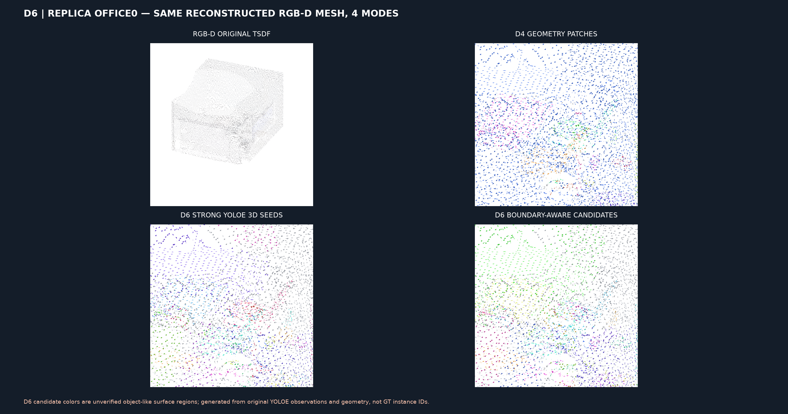

# D6 — отделение кандидатных объектных поверхностей на полной Replica office0

**Verified original sensor-rendered source D4, 500 TSDF RGB-D frames, 200 original YOLOE inference frames.** [Actions 41804336153](https://github.com/KiRiII-C/cv_vlm/actions/runs/41804336153).

| Metric | Real result |
|---|---:|
| Original reconstructed triangle faces | 555,889 |
| Original D4 geometry-only regions | 17 |
| Strong-seed YOLOE-supported faces | 195,476 |
| Strong-seed original mesh area | 33.81% |
| Newly inferred neighbor faces (NOT directly observed label) | 22,385 |
| Reconstructed mesh area with supported or inferred class | 37.71% |
| Disjoint raw-class 3D surface candidates | 46 |
| Disjoint expanded-class 3D surface candidates | 47 |

Strong YOLOE categories are never changed by the grower. The new labels are conditional inference based on class agreement, surface-normal coherence, RGB similarity and spatial proximity; predicted classes may still be wrong. No new YOLOE pass or invented RGB-D frames.

**Critical:** these are class-CONDITIONED connected components on the reconstructed mesh, not full class-agnostic object segmentation, physical instance identities, cross-session tracking or a validated OVI-MAP replacement. More area or more colored regions does not imply improved segmentation IoU.

Original full-resolution GLB and per-face raw versus expanded evidence, plus interactive 3D HTML, are in [run 41804336153 artifacts](https://github.com/KiRiII-C/cv_vlm/actions/runs/41804336153).

An unbiased instance-level PQ comparison awaits aligned original GT mesh and OVI-MAP official instance labels. Its host was unreachable in D5; D6 does not silently substitute wrong vertex order or fabricate scores.
